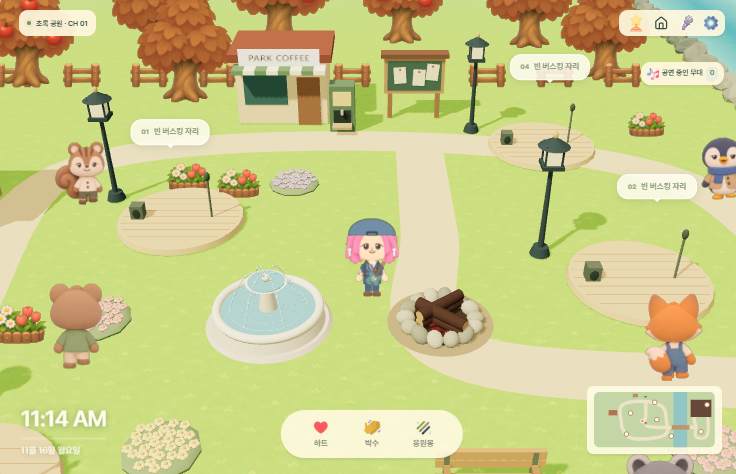
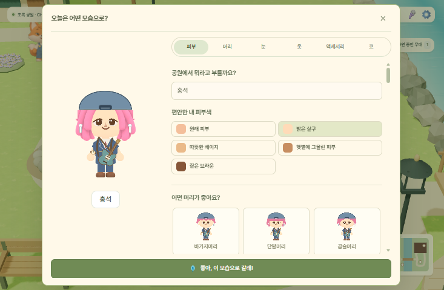
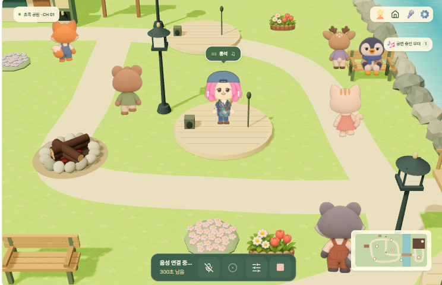

# MUSIC TOWN


뮤직타운의 서비스 소개와 업데이트 소식을 전하는 공식 홍보 사이트입니다.

[공식 사이트](https://music-town-official.gayadi.site/) · [뮤직타운 시작하기](https://music-town.gayadi.site/)

## 뮤직타운 화면



| 캐릭터 꾸미기 | 라이브 공연 |
| :---: | :---: |
|  |  |

## 로컬 실행

Node.js 22.12 이상이 필요합니다.

```sh
npm ci
npm run dev
```

## 빌드

```sh
npm run build
```
